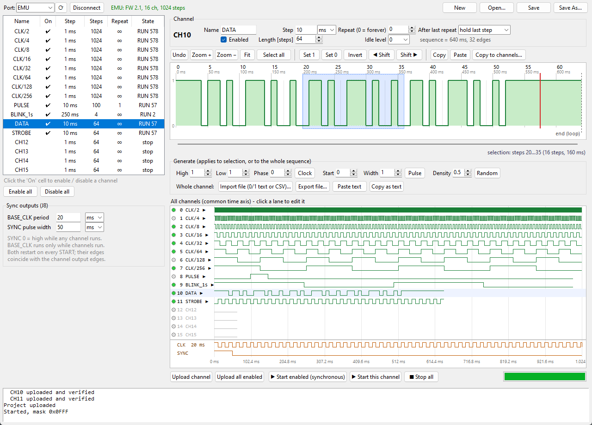

# SeqGen16 – 16-kanałowy cyfrowy generator sekwencji (MAX 10 10M08 Eval Kit)



## Założenia projektu

1. **16 niezależnych kanałów** wyjściowych; każdy kanał to osobny blok w FPGA.
2. **Wyjścia cyfrowe 0/1** (3,3 V LVCMOS) – na tym etapie bez wyjść analogowych.
3. **Sekwencja co najmniej 1024 zmian** na kanał; po końcu: powtórzenie N razy lub pętla.
4. **Rozdzielczość czasu (krok) od 1 ms do 1 s** – ostatecznie rozszerzona do **1 µs … 1 s**, ustawiana
   osobno dla każdego kanału.
5. **Wspólny start** – wybrane kanały ruszają w tym samym takcie zegara.
6. **Wyjścia synchronizujące:** zegar bazowy **BASE_CLK** zsynchronizowany z wyjściami oraz **SYNC**
   ze zboczem narastającym w chwili wyzwolenia sekwencji.
7. **Platforma:** płytka MAX 10 10M08 Evaluation Kit (10M08SAE144C8G).
8. **Architektura:** aplikacja PC (programator sekwencji) ↔ RS-232 ↔ procesor **Nios** w FPGA ↔ bloki
   generatorów (1 blok = 1 kanał).
9. **Źródła FPGA w VHDL.**
10. **Aplikacja PC po angielsku**, z możliwością **narysowania przebiegu każdego wyjścia** oraz
    importu i eksportu sekwencji do pliku.

## Architektura


*Schemat blokowy: [SVG](docs/schemat_blokowy.svg) · [PNG](docs/schemat_blokowy.png)*

- **PC** – aplikacja (GUI / CLI) buduje sekwencje i wysyła je ramkami z CRC16 przez konwerter USB-UART.
- **Nios V/c** w FPGA odbiera ramki przez UART, zapisuje konfigurację i kroki do generatora przez magistralę Avalon-MM.
- **seq_gen16** – 16 identycznych bloków `seq_channel` (każdy z własną pamięcią M9K 1024 kroki × 1 bit,
  sekwencerem i rejestrem wyjściowym), wspólna podstawa czasu 1 µs oraz generator BASE_CLK / SYNC.
- **Wyjścia** – cyfrowe 0/1 (3,3 V LVCMOS) na złączach Arduino (CH0–CH11) i J8 (CH12–CH15, BASE_CLK, SYNC).
- **USB-Blaster** (JTAG) służy tylko do wgrania obrazu FPGA (.sof / .pof).

## Spełnienie wymagań

| Wymaganie | Realizacja |
|---|---|
| 16 kanałów, każdy = 1 blok w FPGA | 16 × `seq_channel.vhd` w `seq_gen16.vhd` |
| rozdzielczość kroku 1 ms … 1 s | krok = N µs, od **1 µs** do 1 s (sprzęt do 1,048 s), wspólna podstawa 1 µs, ustawiany niezależnie dla każdego kanału |
| długość ≥ 1024 zmian | 1 … 1024 kroków na kanał, + powtarzanie 1…65535 razy lub w pętli |
| programowanie z PC | GUI (Tkinter, po angielsku) z edytorem do rysowania przebiegu każdego wyjścia myszą, CLI, projekt w JSON |
| Nios + RS-232 | Nios V/c, UART 115200 8N1, protokół binarny z CRC16 (`PROTOCOL.md`) |
| synchronizacja | kanały z jednej maski START ruszają w tym samym takcie 20 ns |

**Wyjścia:** wszystkie kanały są cyfrowe – w każdym kroku wyjście ma stan 0 lub 1. Po zatrzymaniu
kanał przyjmuje zadany poziom spoczynkowy (idle 0/1); po ostatnim powtórzeniu może trzymać ostatni
krok albo wrócić do poziomu idle.

**Wyjścia synchronizujące (J8):**
- **BASE_CLK** – zegar bazowy o wypełnieniu 50 %, okres ustawiany z PC (2 µs … 2,1 s, domyślnie 1 ms).
  Nadaje tylko wtedy, gdy pracuje dowolny kanał (w spoczynku = 0). Każdy START go restartuje i zaczyna od zbocza
  narastającego, więc jego zbocza wypadają na granicach kroków. Przy ponownym starcie w trakcie pracy BASE_CLK
  i SYNC schodzą na 1 takt (20 ns) do 0, żeby zbocze narastające zawsze wypadło w chwili wyzwolenia.
- **SYNC** – zbocze narastające dokładnie w chwili wyzwolenia sekwencji; impuls o zadanej szerokości
  (domyślnie 1 ms) albo – przy szerokości 0 – stan wysoki, dopóki pracuje dowolny kanał.

Kanały, BASE_CLK i SYNC mają identyczne opóźnienie potokowe, a ich ostatnie rejestry są w komórkach I/O
(FAST_OUTPUT_REGISTER), więc zbocza wypadają w tym samym takcie 50 MHz (rozrzut między pinami to pojedyncze ns).

**Start synchroniczny:** *Start enabled (synchronous)* wysyła jedną komendę START z maską wszystkich włączonych
kanałów, czyli jeden zapis do rejestru – wszystkie kanały z maski ruszają w tym samym takcie zegara. START restartuje
też podstawę czasu 1 µs, więc pierwszy krok trwa dokładnie zadany czas. Kanały uruchamiane osobno (*Start this
channel*) nie są ze sobą zsynchronizowane; START przesuwa też jednorazowo (< 1 µs) podstawę czasu kanałów już pracujących.

## Wyniki kompilacji (Quartus Prime Lite 25.1, sprawdzone)

| Zasób | Użycie |
|---|---|
| Logic elements | 4 555 / 8 064 (56 %) |
| Pamięć | 165 888 / 387 072 bit (43 %) – 16 × M9K na sekwencje + 16 KB RAM Nios |
| Timing @ 50 MHz | setup slack +6,2 ns, hold +0,3 ns (Slow 85 °C) |

Wariant z Nios V/m (debuger JTAG, `build_fpga.ps1 -Cpu niosv_m`) też jest dostępny – zajmuje ok. 1,5–2 tys. LE więcej.

> **Nios II vs Nios V:** Quartus 25.1 nie zawiera już rdzenia Nios II Gen2 w Platform Designerze,
> dlatego użyty jest jego następca Nios V (RISC-V). Architektura systemu jest taka sama.

## Struktura

```
quartus/
  ip/seq_gen16/seq_channel.vhd   blok kanału
  ip/seq_gen16/seq_gen16.vhd     16 kanałów + slave Avalon-MM (mapa rejestrów w nagłówku)
  ip/seq_gen16/seq_gen16_hw.tcl  komponent Platform Designer
  seqgen16_top.vhd               top level (POR, LED-y)
  create_system.tcl              tworzy nios_sys.qsys (Nios V + RAM + UART + generator)
  seqgen16.qsf / .sdc            projekt, piny, timing
  build_fpga.ps1                 pełna budowa
fw/            firmware Nios V (bare-metal C, ~3 KB): main.c, hw.h, crt0.S, link.ld, build.ps1
pc/            seqgen.py (biblioteka), seqgen_gui.py, seqgen_cli.py, patterns.py, emulator.py,
               fw_sim.py (symulator RV32I firmware), test_seqgen.py, test_firmware.py
sim/           tb_seq_gen16.vhd + run_sim.do / run_sim.ps1 (Questa) – testbench samosprawdzający
examples/      demo_16ch.json
docs/          schemat blokowy (SVG/PNG), zrzuty ekranu aplikacji
CLAUDE.md      notatki dla asystenta AI (Claude Code) – stan projektu, decyzje, pułapki
```

## Budowanie

> Quartus nie obsługuje ścieżek > 260 znaków – skopiuj projekt do krótkiej ścieżki, np. `C:\proj\seqgen16`.

1. **Toolchain firmware** – zainstaluj darmowy *Ashling RiscFree IDE for Altera FPGAs*
   (zawiera `riscv32-unknown-elf-gcc`). Jeśli nie jest w `C:\altera_lite\25.1std\riscfree`,
   ustaw `RISCV_TOOLCHAIN` na katalog `bin`.
2. Firmware → `quartus\onchip_ram.hex`:
   ```powershell
   .\fw\build.ps1
   ```
3. FPGA (Platform Designer + kompilacja, ~3 min):
   ```powershell
   .\quartus\build_fpga.ps1
   ```
4. Programowanie: `output_files\seqgen16.sof` (SRAM, do testów) lub `seqgen16.pof` (flash, zostaje po
   wyłączeniu zasilania) przez USB-Blaster na złączu JTAG J10.
   Późniejsze zmiany samego firmware bez ponownej kompilacji FPGA: `.\fw\build.ps1 -UpdateSof`.

## Podłączenie

| Sygnał | Pin FPGA | Złącze |
|---|---|---|
| clk_50 | 27 | oscylator 50 MHz (**sprawdź ze schematem**) |
| uart_rxd (← PC TX) | 74 | Arduino D0 |
| uart_txd (→ PC RX) | 75 | Arduino D1 |
| ch_out[0..5] | 76, 77, 79, 81, 84, 86 | Arduino D2…D7 |
| ch_out[6..11] | 62, 64, 65, 66, 69, 70 | Arduino D8…D13 |
| ch_out[12], ch_out[13] | 60, 59 | J8 pin 3, 5 (DIFFIO_B16P/N) |
| ch_out[14], ch_out[15] | 58, 57 | J8 pin 4, 6 (DIFFIO_B14P/N) |
| clk_base (BASE_CLK) | 56 | J8 pin 7 (DIFFIO_B12P) |
| sync_out (SYNC) | 55 | J8 pin 9 (DIFFIO_B12N) |
| led_n[0..4] | 132, 134, 135, 140, 141 | D1 heartbeat, D2 dowolny kanał pracuje, D3–D5 = kanał 0–2 |

Płytka nie ma transceivera RS-232 – użyj konwertera USB-UART 3,3 V (FT232/CP2102) albo MAX3232 do
prawdziwego portu COM.

Piny J8 pochodzą ze schematu `Altera_10M08S_E144_eval_schematic_REV_1_0.pdf` (arkusz 6, BANK2/BANK3 BREAKOUT);
bank 3 jest zasilany z VCC_IO (3,3 V). **Złącze J8 jest na płytce niewlutowane (DNI)** – trzeba dolutować listwę
2×20 (2,54 mm). Przypisanie J8.3–J8.6 odczytane jest jednoznacznie; J8.7 i J8.9 (BASE_CLK, SYNC) potwierdź przed
podłączeniem omomierzem (pin FPGA 56 / 55 ↔ J8.7 / J8.9) lub z sitodruku.

## Obsługa aplikacji PC (interfejs po angielsku)

```powershell
pip install pyserial
python pc\seqgen_gui.py                                    # GUI; port "EMU" = emulator bez sprzętu
```


Okno składa się z czterech części:

| Obszar | Co zawiera |
|---|---|
| **Pasek górny** | wybór portu (`COMx` lub `EMU`), *Connect / Disconnect*, informacja o urządzeniu; *New / Open / Save / Save As* projektu |
| **Tabela kanałów (lewo)** | nazwa, włączenie (kliknij **On**), krok, liczba kroków, powtórzenia i stan na żywo (`RUN n` = aktualny krok, `DONE`, `stop`); *Enable all / Disable all*; panel **Sync outputs (J8)** z okresem BASE_CLK i szerokością SYNC |
| **Edytor kanału (środek)** | ustawienia wybranego kanału i jego przebieg do rysowania myszą, narzędzia edycji i generatory |
| **Podgląd (dół)** | wszystkie 16 kanałów oraz BASE_CLK i SYNC na wspólnej osi czasu (t = 0 to chwila startu); zielone diody = bieżący stan wyjść; kliknięcie ścieżki wybiera kanał |

### Typowa praca

1. Wybierz port konwertera USB-UART (lub `EMU`, żeby pracować bez płytki) i kliknij **Connect**.
2. Wybierz kanał w tabeli, ustaw **Step** (z jednostką µs / ms / s), **Length**, **Repeat** i poziom **Idle**.
3. Narysuj przebieg w edytorze albo wygeneruj go (*Clock*, *Pulse*, *Random*) lub wczytaj (*Import file…*).
4. Włącz potrzebne kanały (kolumna **On**) i ustaw BASE_CLK / SYNC.
5. **Upload all enabled** – wysyła ustawienia i sekwencje oraz sprawdza je odczytem z urządzenia.
6. **▶ Start enabled (synchronous)** – wszystkie włączone kanały ruszają w tym samym takcie; **■ Stop all** zatrzymuje.
7. **Save** zapisuje cały projekt (JSON), **Export file…** – sekwencję jednego kanału (.txt / .csv).

### Edytor przebiegu


Niebieski obszar to zaznaczenie (tu kroki 20…35), czerwona linia – krok, który urządzenie właśnie odtwarza.
Nad wykresem: numery kroków i czas od początku sekwencji; przerywana linia na końcu – koniec sekwencji
i co dzieje się dalej (`loop`, `x3, then hold` itp.).

| Akcja | Jak |
|---|---|
| rysowanie stanu 1 / 0 | przeciągnij lewym / prawym przyciskiem myszy po krokach |
| zaznaczenie zakresu | Shift + przeciągnięcie (Esc – odznacz, Ctrl+A – wszystko) |
| przewijanie / powiększenie | kółko myszy / Ctrl + kółko, przyciski Zoom +/−, Fit |
| cofnij | Ctrl+Z lub *Undo* (200 kroków wstecz) |
| operacje na zaznaczeniu (lub całości) | *Set 1*, *Set 0*, *Invert*, *◀ Shift / Shift ▶* (rotacja), *Copy / Paste* |
| generatory | *Clock* (High/Low/Phase w krokach), *Pulse* (Start/Width), *Random* (gęstość) |
| import / eksport | *Import file…* / *Export file…*: tekst `0101…` (.txt) lub CSV `level,time_ms` (.csv) – eksport wczytuje się z powrotem bez zmian; przy imporcie CSV liczy się pierwsza kolumna (≠ 0 → 1), linie `#` to komentarze; *Paste text*, *Copy as text* |
| kopiowanie na inne kanały | *Copy to channels…* (opcjonalnie z ustawieniami czasu) |

Parametry kanału: nazwa, włączony, czas kroku (1 µs … 1 s, rozdzielczość 1 µs; pole z wyborem jednostki
µs / ms / s – tak samo dla BASE_CLK i SYNC), długość (1…1024 kroki), liczba powtórzeń (0 = w pętli),
poziom idle, zachowanie po ostatnim powtórzeniu (*hold last step* / *go to idle level*).

Projekt JSON (wersja 3): `clock_period_ms`, `sync_width_ms` oraz dla każdego kanału `name`, `enabled`, `period_ms`, `loops`, `idle`, `idle_on_done`,
`steps` (lista 0/1). Upload weryfikuje zawartość pamięci odczytem; pełne 16 × 1024 kroków ≈ 2 s przy 115200 bd.

### Linia poleceń (CLI)

```powershell
python pc\seqgen_cli.py ports
python pc\seqgen_cli.py -p COM5 upload examples\demo_16ch.json --start
python pc\seqgen_cli.py -p COM5 status
python pc\seqgen_cli.py -p COM5 stop all
python pc\seqgen_cli.py show examples\demo_16ch.json       # podgląd sekwencji jako 0/1
```

Testy: `cd pc ; python -m unittest test_seqgen test_firmware -v` (`test_firmware` uruchamia zbudowany `fw/build/fw.bin`).

## Stan weryfikacji

- ✅ Pełna kompilacja Quartus (synteza, fitter, timing, .sof/.pof) dla VHDL + Nios V/c.
- ✅ Firmware 2.1: zbudowany toolchainem RiscFree (GCC 13.2, RV32I) – 2,6 KB kodu + 2,3 KB danych w 16 KB RAM, wpisany do `seqgen16.sof/.pof`.
- ✅ Firmware wykonany w symulatorze zestawu instrukcji RV32I (`pc/fw_sim.py`) z modelami UART i rejestrów generatora: 15 testów (`pc/test_firmware.py`) przez prawdziwą bibliotekę PC – protokół, konfiguracja rejestrów, zapis/odczyt 1024 kroków, pętle, błędne CRC, śmieci na linii, nieznane komendy. Obsługa jednego odebranego bajtu to ~115 instrukcji, czyli kilkukrotny zapas względem 86,8 µs na bajt przy 115200 bd.
- ✅ Aplikacja PC: 37 testów (biblioteka na emulatorze + te same scenariusze na firmware, m.in. krok 1 µs, eksport/import)
  + automatyczny test GUI (rysowanie, zaznaczanie, generator, undo, włączanie kanałów w tabeli, pola czasu µs/ms/s,
  BASE_CLK/SYNC, eksport/import pliku, upload, start) i CLI na emulatorze.
- ✅ Symulacja RTL w Questa: `sim/run_sim.ps1` → **TEST PASSED** (zapis/odczyt 1024 kroków, stany i czasy kroków,
  pętle i zakończenie, synchronizacja kanałów co do taktu, STOP, poziom idle, krok 1 ms = dokładnie 50 000 taktów, krok 1 µs = 1000 ns,
  zbocza SYNC / BASE_CLK w tym samym czasie co zmiany kanałów – także przy ponownym starcie). Symulacja wykryła
  i pomogła usunąć błąd: BASE_CLK będący w stanie 1 w chwili START nie dawał zbocza narastającego.
- ⚠️ Nie testowano na sprzęcie.
